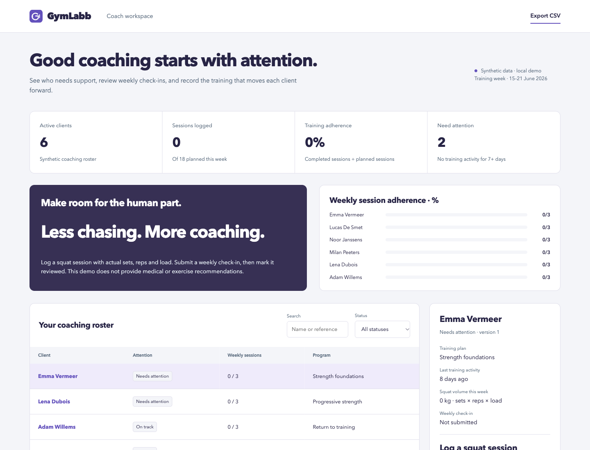

# GymLabb

A working coaching workspace for training-session logging, weekly check-ins and coach review, built from the original product specification.

[](https://github.com/phlppgdfry/gymlabb-platform-spec/actions/workflows/demo.yml)



## Run it in one command

Requires Python 3.11+ with SQLite support. No pip install, account, API key or Node runtime is needed to run the application.

```bash
git clone https://github.com/phlppgdfry/gymlabb-platform-spec.git
cd gymlabb-platform-spec
python3 -m demo.server
```

Open **http://127.0.0.1:8113**. The first start seeds `var/demo.sqlite3`; later starts preserve changes. The server binds to loopback only.

Use a new database path for a fresh workspace, without overwriting existing work:

```bash
python3 -m demo.server --port 8213 --db var/fresh-demo.sqlite3
```

## Try the complete workflow

1. Select Emma Vermeer and save a squat session with 3 sets × 8 reps × 40 kg. Weekly logged volume becomes 960 kg.
2. Submit a fictional weekly check-in with sleep, energy and a note. Mark the check-in reviewed as the coach.
3. Reload and select Emma again to verify the session and review state persist. Submit another check-in to reopen review.

Search and status filtering, record inspection, CSV export, input errors, an activity log, responsive layouts, individual SVG branding, favicons and Apple touch icons are included.

## Why this project exists

Coaches managing clients through notes and messages lack a reliable view of training activity and unreviewed check-ins.

The implementation completes one demonstrable product slice, with explicit business rules and verifiable state changes. This is a **local portfolio demonstration with synthetic data**, not an operating service or evidence of client outcomes.

## Business rules

- A week contains three planned squat sessions per client; a fourth is rejected. One log uses the same reps and load across its sets.
- Training volume = sum(sets × reps × load kg). Weekly adherence = recorded sessions ÷ planned sessions; sessions are never pre-marked completed.
- Training inactivity ≥7 days takes priority over unreviewed check-ins. Logging a workout resets training inactivity to zero; sending a check-in does not fabricate training activity.
- Energy must be an integer 1–5; sleep 0–16 hours; sets 1–10; reps 1–50; load 0–300 kg. These are software input bounds, not training recommendations.

## Verify and reproduce

```bash
make check                 # domain, HTTP, transaction and concurrency tests + syntax checks
make report                # deterministic baseline JSON and CSV; does not modify the database
```

Node 24+ is used only for JavaScript syntax checks and browser verification. The browser suite has a pinned development dependency:

```bash
npm ci
npx playwright install chromium
npm run test:e2e
```

The six Chromium tests start an isolated Python server and temporary database, then clean it up. They cover branding/assets, filtering, 390/768/1440 px widths and the complete domain workflow. GitHub Actions also runs Python tests on 3.11 and 3.14. See [validation evidence](docs/validation.md).

Baseline evidence is committed in [reports/baseline/snapshot.json](reports/baseline/snapshot.json) and [records.csv](reports/baseline/records.csv). These are generated from the fixtures, not a screenshot of arbitrary runtime state.

## Engineering decisions

**Complete the feedback loop first.** Logging, client check-in and coach review demonstrate one coherent product slice rather than five unfinished epics.

**Keep wellbeing data fictional.** No real health records, identity or medical recommendations belong in this unauthenticated demonstration.

**Make review state explicit.** Editing a check-in resets reviewed=False so a previous coach acknowledgement never applies to new content.

The browser uses semantic HTML, native JavaScript modules and CSS. The Python application separates input contracts, domain rules, transactional persistence and HTTP transport. Records use optimistic version checks; each mutation and its audit entry commit together. Rejected actions leave both unchanged.

## Scope and evidence

One trusted workspace demonstrates both coach and client actions. No authentication, tenant isolation, native iOS app, nutrition tracking, billing, notifications, offline mobile sync or HealthKit integration is delivered.

The June concept is retained in [original-concept.md](docs/original-concept.md), explicitly labelled as unverified history. Current functionality is defined by the source, tests and this README. The demo has no authentication or tenant boundaries; use fictional data and keep it local.

## Explore the repository

| Resource | Purpose |
| --- | --- |
| [demo/domain.py](demo/domain.py) | Fixtures, calculations and use cases |
| [demo/store.py](demo/store.py) | SQLite transactions, optimistic versions and audit log |
| [demo/web/feature.js](demo/web/feature.js) | Domain-specific forms and details |
| [tests](tests) | Domain, persistence, HTTP and browser verification |
| [Architecture](docs/architecture.md) | Boundaries, tradeoffs and data flow |
| [API contract](docs/api.md) | Routes, payloads and errors |
| [Case study](docs/case-study.md) | Problem, acceptance criteria and delivery scope |
| [Runbook](docs/runbook.md) | Start, inspect, export and recover |
| [Mobile preview](docs/mobile.png) | 390 px workspace |

Built by [Philippe Godfroy](https://github.com/phlppgdfry).
