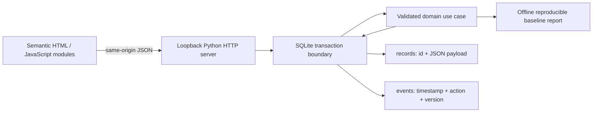

# Architecture and tradeoffs

## The product boundary

A working coaching workspace for training-session logging, weekly check-ins and coach review, built from the original product specification.

This repository is self-contained. It shares no runtime package, database, service or account with the other portfolio demos. Similar infrastructure is intentionally simple; the business rules live in this repository and are tested here.

## Mutation protocol

1. Parse a bounded JSON object; reject malformed or non-finite values.
2. Check local Host and browser Origin. There is no cross-origin write permission.
3. Begin a SQLite `IMMEDIATE` transaction before loading the current records.
4. For updates, require the client record version to match the current version. A stale client receives HTTP 409 and must use refreshed state.
5. Validate the use case, derive authoritative values on the server, write the record and append its versioned audit entry.
6. Commit together, then return a consistent snapshot. Any exception rolls back both writes; a fault-injection test verifies audit failure cannot leave an unaudited record change.

Snapshots read records and events inside one read transaction. Connections are request-local and closed explicitly. The primary key prevents duplicate record IDs; parameterized statements keep input out of SQL syntax. The activity list shows the latest 12 events while the database retains all of them.

## Why this stack

A clone-and-run demonstration benefits from zero runtime dependencies. Python’s standard-library HTTP server and SQLite make the workflow inspectable without infrastructure setup. Native browser modules keep the UI build-free. Playwright is a pinned development dependency only. This choice is appropriate for a trusted local demonstration, not an internet-facing multi-user service.

The record payload is JSON because each workspace has one small aggregate type and no reporting warehouse. This gives a compact, reviewable implementation. Schema evolution would need explicit migrations beyond the current initial `seed_version=1`; storing a seed marker is not a migration system.

## Deliberate limits

One trusted workspace demonstrates both coach and client actions. No authentication, tenant isolation, native iOS app, nutrition tracking, billing, notifications, offline mobile sync or HealthKit integration is delivered.

There is no login, role-based access, tenant isolation, distributed processing, rate limiting, monitored SLA or encrypted data store. The local audit trail is useful for explanation but is not tamper-proof. A public service would first need identity/ownership rules, a supported production server, migrations, secrets management, monitoring, restore testing and domain integrations. Those are future engineering decisions, not delivered claims.

## Domain decisions

### Complete the feedback loop first

Logging, client check-in and coach review demonstrate one coherent product slice rather than five unfinished epics.

### Keep wellbeing data fictional

No real health records, identity or medical recommendations belong in this unauthenticated demonstration.

### Make review state explicit

Editing a check-in resets reviewed=False so a previous coach acknowledgement never applies to new content.
